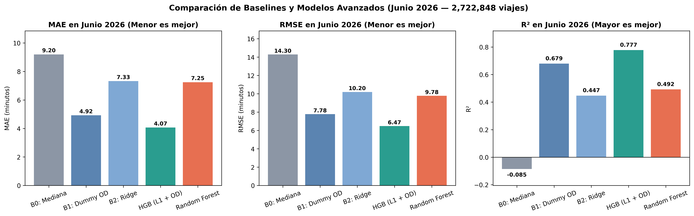
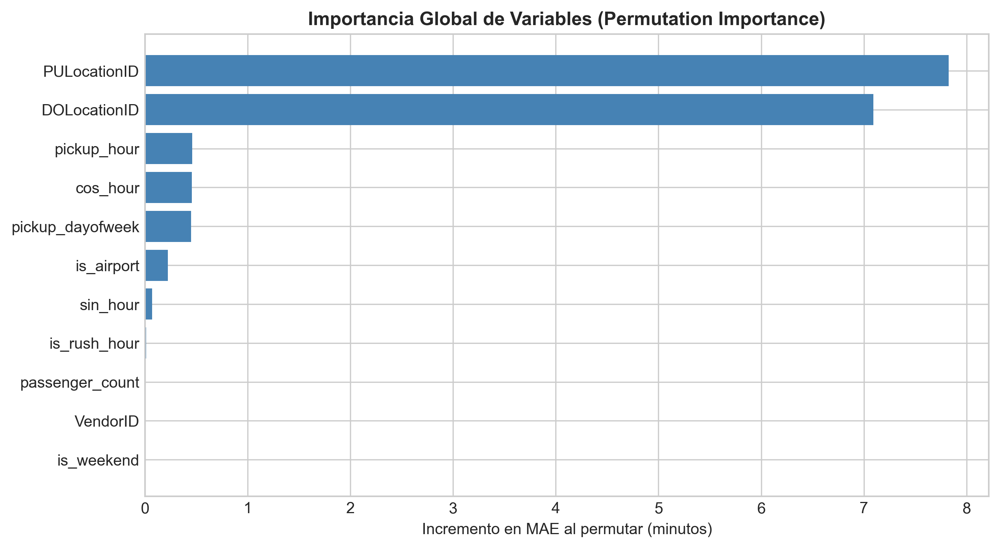
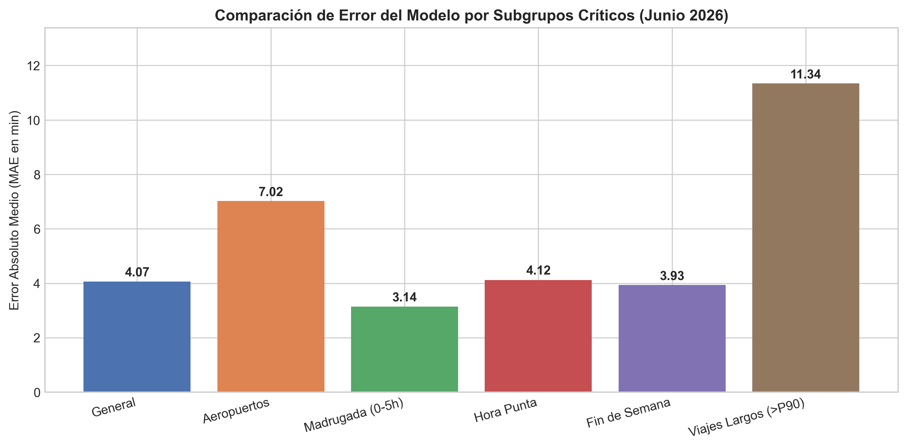

# Informe Final: Predicción de Duración de Viajes en Taxis de NYC

## 1. Resumen ejecutivo

Este proyecto aborda la predicción de la duración de viajes de los *Yellow Taxis* de la ciudad de Nueva York (`trip_duration`, en minutos) **antes de que el trayecto inicie**, utilizando el 100% de los registros oficiales de la *NYC Taxi & Limousine Commission* (TLC) correspondientes a **seis meses completos de 2026 (Enero a Junio)**: **22,836,530 viajes crudos** y **16,409,232 viajes limpios válidos**.

Mediante una partición temporal estricta (~80/20 por meses completos: Enero–Mayo para entrenamiento y Junio para evaluación), control riguroso contra fuga de información (*data leakage*) y optimización de memoria RAM (*downcasting* >89% de ahorro), se compararon tres familias de modelos: estimadores empíricos (`Baseline 0` y `Baseline 1`), regresión lineal regularizada (`Ridge`) y ensambles de árboles (`Random Forest` y `HistGradientBoosting`).

El modelo ganador fue **`HistGradientBoostingRegressor` optimizado con función de pérdida L1 (`loss="absolute_error"`) e interacción Origen–Destino (`ODPairTransformer`)**, alcanzando en el conjunto de prueba de Junio (`2,722,848` viajes) un **MAE de `4.0651` minutos**, **RMSE de `6.4749` minutos** y **$R^2$ de `0.7774`**. Este resultado reduce el error absoluto medio en **55.81%** frente al baseline constante (`9.1992` min) y en **17.44%** frente al exigente baseline histórico por par origen–destino (`4.9237` min). El análisis de errores confirma un desempeño sólido en viajes urbanos y madrugada (`MAE = 3.1444` min), concentrándose el mayor error en trayectos hacia aeropuertos (`7.0193` min) y viajes largos >P90 (`11.3384` min) debido a factores exógenos no observables antes de abordar (clima y congestión imprevista).

---

## 2. Descripción del problema

* **Pregunta predictiva:** *¿Es posible predecir la duración de un viaje en taxi amarillo en la ciudad de Nueva York antes de que inicie, utilizando únicamente información disponible al momento de abordar (origen, destino, fecha/hora y número de pasajeros) sobre un histórico de 6 meses de 2026?*
* **Tipo de problema:** Aprendizaje supervisado de **regresión** continua.
* **Variable objetivo (*target*):** `trip_duration` (en minutos), derivada de `tpep_dropoff_datetime - tpep_pickup_datetime`.
* **Unidad de predicción:** Cada fila representa un viaje individual completado.
* **Relevancia operativa:** Estimar con precisión la duración antes de iniciar el servicio permite mejorar la estimación de tiempo de llegada (ETA) para pasajeros, optimizar el despacho de flotas y ofrecer referencias transparentes de tiempo de recorrido sin utilizar variables post-viaje.

---

## 3. Descripción del dataset

* **Fuente y licencia:** Registros públicos oficiales *Yellow Taxi Trip Records* de la *NYC Taxi & Limousine Commission* (TLC), disponibles abiertamente a través del portal de datos públicos de NYC (`nyc.gov/site/tlc/about/tlc-trip-record-data.page`).
* **Periodo y volumen:** Seis archivos mensuales consecutivos en formato Parquet (**Enero a Junio de 2026**), sumando **22,836,530 registros crudos** y **21 columnas originales**.
* **Estructura y decisiones de muestreo:**
  * No se realizó submuestreo arbitrario para el entrenamiento ni para la evaluación final: se procesó el **100% de los 6 meses** mediante lectura selectiva de columnas, procesamiento mensual secuencial y *downcasting* de tipos numéricos en `src/data.py` y `src/features.py`.
  * Los **16,409,232 registros limpios** con sus **13 columnas procesadas** ocupan **375.58 MB en RAM** (frente a `1,627.51 MB` con tipos estándar `int64/float64`, y `3,484.58 MB` frente a la tabla cruda completa) y **58.51 MB en disco** (compresión `zstd`).
  * Únicamente la etapa de búsqueda aleatoria de hiperparámetros (`RandomizedSearchCV`) empleó submuestras temporales controladas (`80,000` viajes de Enero–Abril y `30,000` de Mayo) para hacer viable la exploración combinatoria dentro de 16 GB de RAM, reentrenando luego el modelo definitivo sobre el 100% de Enero–Mayo (`13,686,384` filas).

---

## 4. Limpieza y preparación de datos

### 4.1. Control estricto de *Data Leakage*
Para garantizar validez en producción pre-viaje, en la lectura desde disco (`REQUIRED_RAW_COLS` en `src/data.py`) se excluyeron **14 columnas con fuga de información** generadas durante o al final del trayecto (incluyendo `tpep_dropoff_datetime`, `trip_distance`, `fare_amount`, `tip_amount`, `tolls_amount`, `total_amount`, `congestion_surcharge`, `Airport_fee`, entre otras). Posteriormente, `FeatureExtractor(drop_datetime=True)` extrajo los componentes temporales de `tpep_pickup_datetime` y descartó el timestamp crudo, verificando **0 columnas de fuga** en el archivo procesado (`data/processed/yellow_tripdata_processed.parquet`).

### 4.2. Filtrado de registros anómalos y valores faltantes
* Se filtraron únicamente viajes del año `2026` y meses `1..6`.
* Se exigió duración válida entre **`1.0` y `120.0` minutos** (`trip_duration`), descartando registros negativos, viajes instantáneos o carreras no cerradas.
* Se eliminaron registros con valores nulos en `VendorID`, `PULocationID`, `DOLocationID`, `tpep_pickup_datetime` o `trip_duration`, y se imputó/validó `passenger_count` (acotado al rango válido `>= 0`).
* En total se descartaron **6,427,298 registros (28.14%)**, conservando **16,409,232 viajes limpios válidos (71.86%)**.

### 4.3. Ingeniería de características (`src/features.py`)
Se construyeron **11 variables predictoras** compactas (`int8`, `uint16`, `float32`):
* **Espaciales:** `PULocationID` (zona de origen), `DOLocationID` (zona de destino), `is_airport` (bandera binaria si origen o destino pertenece a JFK=132, LaGuardia=138 o Newark=1) y `VendorID`.
* **Temporales y cíclicas:** `pickup_hour`, `pickup_dayofweek`, `is_weekend`, `is_rush_hour` (lunes a viernes de 7–9h y 16–19h), `sin_hour` y `cos_hour` (preservando continuidad circular entre las 23:00 y las 00:00h).
* **Demanda:** `passenger_count`.
* **Interacción Origen–Destino (`ODPairTransformer`):** en el pipeline de *Gradient Boosting* se genera `od_pair = PULocationID * 1000 + DOLocationID` para capturar la relación exacta ruta–distancia entre cada par de zonas.

---

## 5. Análisis exploratorio

El EDA en `notebooks/01_exploracion_inicial.ipynb` y `notebooks/02_limpieza_features.ipynb` reveló los hallazgos clave que guiaron el modelado:

1. **Valores faltantes concentrados:** en el dataset crudo (`22.84M` filas), `request_source` presentaba **95.56%** de nulos, mientras que `passenger_count`, `RatecodeID`, `store_and_fwd_flag`, `congestion_surcharge` y `Airport_fee` compartían exactamente **25.51%** (`5,825,780` filas) de valores faltantes asociados a un mismo subconjunto de reportes de taxímetro.
2. **Anomalías severas en crudo:** la duración sin filtrar abarcaba desde **`-186.67` min** hasta **`9,983.93` min**, incluyendo **286,182 viajes** con duración `<= 0` min, **8,252** con duración `> 180` min y **508,876** con distancia `0` y duración `> 5` min.
3. **Asimetría positiva de la variable objetivo:** tras la limpieza (`16.41M` filas), `trip_duration` presenta una media de **`17.53` min** (desviación estándar `14.92` min), mediana de **`13.08` min** y percentil 95 de **`48.25` min**. Esta cola larga derecha justifica usar la **mediana** como referencia inicial y **MAE** como métrica principal.
4. **Patrones temporales y espaciales:** se observó una caída de duración promedio en la madrugada (00:00–05:00h), picos sostenidos durante la jornada laboral/vespertina y una duración sustancialmente mayor en trayectos con origen o destino en aeropuertos (`is_airport = 1`).

---

## 6. Estrategia de partición y validación

Respetando la naturaleza secuencial del tráfico urbano y evitando cualquier fuga del futuro (*look-ahead bias*), la partición se realizó estrictamente por **meses completos (~80/20)**:

* **Conjunto de entrenamiento completo (`train_val`):** **Enero a Mayo de 2026** (5 meses) — **`13,686,384` viajes (`83.41%`)**.
  * Sub-partición para búsqueda de hiperparámetros (`PredefinedSplit`): **Enero–Abril** (`10,659,746` viajes) para ajuste y **Mayo** (`3,026,638` viajes) para validación y selección de arquitectura sin tocar Junio.
* **Conjunto de evaluación final (`test`):** **Junio de 2026** (1 mes) — **`2,722,848` viajes (`16.59%`)**, utilizado exclusivamente para reportar métricas definitivas.

### Selección de métricas
* **Métrica principal — MAE (*Mean Absolute Error*):** interpretable directamente en minutos y robusta frente a valores atípicos en la cola derecha.
* **Métricas secundarias — RMSE y $R^2$:** el RMSE penaliza con mayor fuerza errores grandes (útil para detectar fallos severos en viajes largos), mientras que $R^2$ mide la proporción de varianza explicada.

---

## 7. Baselines

Para establecer una referencia honesta y progresiva, se implementaron tres líneas base en `notebooks/03_modelos.ipynb`, evaluadas sobre el conjunto de Junio (`2,722,848` viajes):

1. **Baseline 0 — Mediana Global (`13.07` min en Ene–May):** predictor constante insensible a ruta u hora. Obtuvo **`MAE = 9.1992` min**, `RMSE = 14.2975` min y `R² = -0.0852`.
2. **Baseline 1 — Dummy por Par Origen–Destino:** tabla de búsqueda con la mediana histórica de cada par `(PULocationID, DOLocationID)` en Enero–Mayo (los `428` viajes de Junio sin historial previo —`0.0157%`— reciben la mediana global). Al capturar la distancia implícita entre zonas, logró **`MAE = 4.9237` min** (`-46.48%` respecto a Baseline 0), `RMSE = 7.7802` min y `R² = 0.6787`.
3. **Baseline 2 — Regresión Ridge Regularizada:** pipeline lineal (`StandardScaler` + `OneHotEncoder` disperso). Logró **`MAE = 7.3279` min**, `RMSE = 10.2034` min y `R² = 0.4473`; supera al predictor constante, pero al ser aditivo lineal no logra modelar la interacción 2D entre origen y destino ni la no linealidad horaria.

---

## 8. Modelos entrenados

Con el fin de evaluar **tres familias distintas de modelos** (estimadores empíricos, modelos lineales regularizados y ensambles de árboles) en `src/train.py`, se entrenaron dos modelos avanzados basados en árboles sobre la misma partición temporal:

1. **Random Forest Optimizado (`RandomForestRegressor`):** pipeline con `OneHotEncoder(handle_unknown="ignore", sparse_output=True, dtype=np.float32)` y `max_samples=150,000` por árbol para mantenerse dentro de 16 GB de RAM sobre 13.68M filas.
2. **HistGradientBoosting Optimizado con pérdida L1 e interacción OD (`HistGradientBoostingRegressor`):**
   * Incorpora `ODPairTransformer` para crear la variable exacta `od_pair` junto con `PULocationID`, `DOLocationID` y `VendorID`.
   * Utiliza `TargetEncoder(target_type="continuous", smooth="auto", cv=5, random_state=42)` para evitar matrices One-Hot densas de cientos de columnas en RAM y preservar la señal estadística de cada ruta sin *data leakage*.
   * **Justificación de la función de pérdida L1 (`loss="absolute_error"`):** por defecto, los modelos de *Gradient Boosting* minimizan la pérdida cuadrática (**L2**), estimando la media condicional y amplificando cuadráticamente los residuos de viajes atípicos muy largos. Al especificar **L1 (`absolute_error`)**, el algoritmo estima la **mediana** condicional, alinea el gradiente de entrenamiento directamente con la métrica principal del proyecto (**MAE**) y mantiene gradiente acotado (`±1`) frente a *outliers* de congestión extrema.

---

## 9. Búsqueda de hiperparámetros

La optimización se realizó en `src/train.py` mediante `RandomizedSearchCV` (`n_iter=4`, `scoring="neg_mean_absolute_error"`, `random_state=42`) con validación temporal estricta `PredefinedSplit` sobre muestras de **Enero–Abril (`80,000` viajes)** como entrenamiento y **Mayo (`30,000` viajes)** como validación:

* **Espacio evaluado en Random Forest:** `n_estimators` (`[50, 100]`), `max_depth` (`[10, 20, 30]`), `min_samples_split` (`[2, 5, 10]`), `min_samples_leaf` (`[1, 2, 4]`), `max_features` (`["sqrt", 0.7]`).
* **Espacio evaluado en HistGradientBoosting (L1 + OD):** `learning_rate` (`[0.05, 0.1]`), `max_iter` (`[150, 250]`), `max_leaf_nodes` (`[31, 63, 127]`), `l2_regularization` (`[0.0, 0.1, 1.0]`).
* **Comparación en validación (Mayo):**
  * Random Forest: `MAE = 8.1621` min.
  * **HistGradientBoosting (L1 + OD): `MAE = 5.2149` min** (modelo seleccionado).
* **Mejores hiperparámetros del modelo ganador:** `loss='absolute_error'`, `learning_rate=0.1`, `max_iter=250`, `max_leaf_nodes=127`, `l2_regularization=1.0`, `min_samples_leaf=20`, `random_state=42`.

---

## 10. Evaluación final

Tras reentrenar sobre el 100% de **Enero–Mayo (`13,686,384` viajes)** y evaluar en **Junio 2026 (`2,722,848` viajes)**, la tabla comparativa consolidada (`outputs/metrics.json`) es:

| Modelo | Familia | MAE (min) | RMSE (min) | $R^2$ | Mejora MAE vs. B0 | Mejora MAE vs. B1 |
| :--- | :--- | :---: | :---: | :---: | :---: | :---: |
| Baseline 0: Mediana Global | Estadístico constante | 9.1992 | 14.2975 | -0.0852 | 0.00% | -86.84% |
| Baseline 2: Regresión Ridge Regularizada | Lineal regularizado | 7.3279 | 10.2034 | 0.4473 | +20.34% | -48.83% |
| Random Forest Optimizado | Ensamble Bagging | 7.2496 | 9.7786 | 0.4924 | +21.19% | -47.24% |
| Baseline 1: Dummy por Par Origen-Destino | Empírico por ruta | 4.9237 | 7.7802 | 0.6787 | +46.48% | 0.00% |
| **HistGradientBoosting Optimizado (L1 + OD)** | **Ensamble Boosting (L1)** | **4.0651** | **6.4749** | **0.7774** | **+55.81%** | **+17.44%** |



`HistGradientBoosting Optimizado (L1 + OD)` supera de forma contundente a todos los baselines y al resto de modelos en las tres métricas, logrando explicar el **77.74%** de la varianza temporal del servicio con un error medio cercano a los **4 minutos** sin utilizar variables post-viaje.

---

## 11. Interpretación

La importancia global de variables calculada en `notebooks/04_analisis_errores.ipynb` mediante *Permutation Importance* sobre una muestra de `3,000` viajes de Junio (evaluada por incremento en `MAE` al permutar cada predictor) evidencia una jerarquía clara y coherente con la física del transporte urbano:

1. **Dominio espacial (`PULocationID` y `DOLocationID`):** representan con diferencia el mayor peso predictivo porque determinan conjuntamente el par origen–destino (`od_pair`), es decir, la distancia y corredor vial del trayecto.
2. **Dinámica temporal (`pickup_hour`, `sin_hour`, `cos_hour`, `pickup_dayofweek`, `is_rush_hour`, `is_weekend`):** constituyen el segundo bloque de importancia, modulando el tiempo base de cada ruta según el nivel de congestión horaria y el patrón laboral vs. fin de semana.
3. **Señal aeroportuaria (`is_airport`) y variables marginales (`passenger_count`, `VendorID`):** la bandera de aeropuerto refuerza el efecto de rutas de larga distancia, mientras que el número de pasajeros y el proveedor del taxímetro tienen impacto prácticamente nulo sobre la velocidad del tráfico.



---

## 12. Análisis de errores

La segmentación de errores sobre los `2,722,848` viajes de Junio 2026 (`notebooks/04_analisis_errores.ipynb`) arroja los siguientes resultados por subgrupo crítico:

| Subgrupo analizado | Cantidad de viajes | MAE (min) | Lectura frente al MAE general (`4.0651` min) |
| :--- | :---: | :---: | :--- |
| **General (Junio 2026)** | 2,722,848 | **4.0651** | Referencia global en test |
| **Madrugada (00:00–05:00h)** | 204,411 | **3.1444** | `-22.65%` menor error por tráfico fluido y predecible |
| **Fin de Semana** | 656,947 | **3.9330** | `-3.25%` menor error respecto al promedio |
| **Hora Punta (L–V 7–9h, 16–19h)** | 800,032 | **4.1227** | `+1.42%` ligero aumento por variabilidad de congestión |
| **Aeropuertos (JFK / LGA / EWR)** | 293,894 | **7.0193** | `+72.67%` mayor error por trayectos largos en autopistas y puentes |
| **Viajes Largos (> Percentil 90)** | 272,228 | **11.3384** | `+178.92%` mayor error; concentra la cola derecha no determinista |



Los errores elevados en aeropuertos y viajes >P90 se explican porque el error absoluto tiende a crecer proporcionalmente con la duración del trayecto y porque el modelo L1 predice la mediana condicional, subestimando picos excepcionales causados por accidentes o atascos severos en puentes y túneles.

---

## 13. Riesgos éticos, sesgos y limitaciones

* **Sesgo de cobertura geográfica (*Yellow Taxis*):** la flota de taxis amarillos opera predominantemente en Manhattan y los tres aeropuertos principales. Los viajes iniciados o finalizados en zonas periféricas (*outer boroughs* como Bronx, Staten Island o el este de Queens) tienen menor densidad histórica en el entrenamiento, lo que puede producir estimaciones menos precisas o sesgadas hacia la media global en dichas zonas.
* **Ausencia de variables exógenas en tiempo real:** el registro TLC no contiene condiciones meteorológicas (lluvia, nieve), incidentes viales, obras en vía pública, manifestaciones ni eventos masivos. Esto limita el techo predictivo en viajes largos sujetos a disrupciones repentinas.
* **Riesgo de *Concept Drift* estacional:** el modelo entrenado en Enero–Mayo refleja patrones de invierno y primavera; cambios en vacaciones de verano, clima extremo o modificaciones tarifarias pueden degradar progresivamente el desempeño si no se reentrena periódicamente.
* **Uso responsable:** un sistema de ETA basado en este modelo debe comunicarse con intervalos de incertidumbre en viajes hacia aeropuertos para evitar que usuarios pierdan vuelos por confiar únicamente en la mediana puntual.

---

## 14. Trabajo futuro

1. **Variables exógenas y calendario:** incorporar series horarias de clima de NYC (precipitación, temperatura, nieve vía NOAA) y calendario de días feriados/eventos masivos.
2. **Geometría vial y distancia entre zonas:** añadir la distancia geodésica/de red vial entre los centroides de `PULocationID` y `DOLocationID` (disponibles en el *TLC Taxi Zone Lookup*) para mejorar la generalización en rutas poco frecuentes.
3. **Incertidumbre predictiva:** entrenar variantes con pérdida cuantílica (`loss="quantile"`, cuantiles 0.1, 0.5 y 0.9) para entregar rangos de duración esperada en viajes críticos como aeropuertos.
4. **Comparación con LightGBM / CatBoost:** evaluar LightGBM con soporte nativo de alta cardinalidad y optimización distribuida sobre el historial anual completo (12 meses).

---

## 15. Instrucciones de reproducción

Todas las semillas están fijadas en `RANDOM_STATE = 42`. Para reproducir íntegramente el proyecto desde cero:

1. **Instalar dependencias:**
   ```bash
   pip install -r requirements.txt
   ```
2. **Verificar datos crudos:** confirmar que los 6 archivos `yellow_tripdata_2026-01.parquet` a `2026-06.parquet` estén en `data/raw/` (según `data/README.md`).
3. **Ejecutar el flujo en orden:**
   * `notebooks/01_exploracion_inicial.ipynb`: análisis exploratorio inicial de los 6 meses (`22.84M` filas).
   * `notebooks/02_limpieza_features.ipynb`: limpieza, auditoría de *leakage*, *downcasting* y exportación de `data/processed/yellow_tripdata_processed.parquet` (`16.41M` filas).
   * `notebooks/03_modelos.ipynb` o directamente desde terminal:
     ```bash
     python src/train.py
     ```
     Este script realiza el tuning en Ene–Abr/Mayo, reentrena en Ene–May, evalúa en Junio, guarda el modelo ganador en `models/best_model.joblib` y actualiza `outputs/metrics.json`.
   * `notebooks/04_analisis_errores.ipynb`: genera la importancia de variables, la evaluación por subgrupos críticos y exporta los gráficos en `reports/figures/`.
